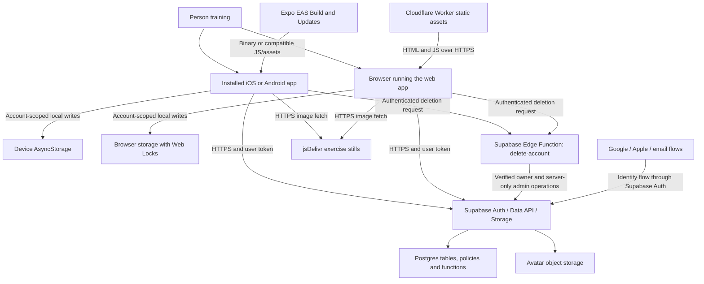
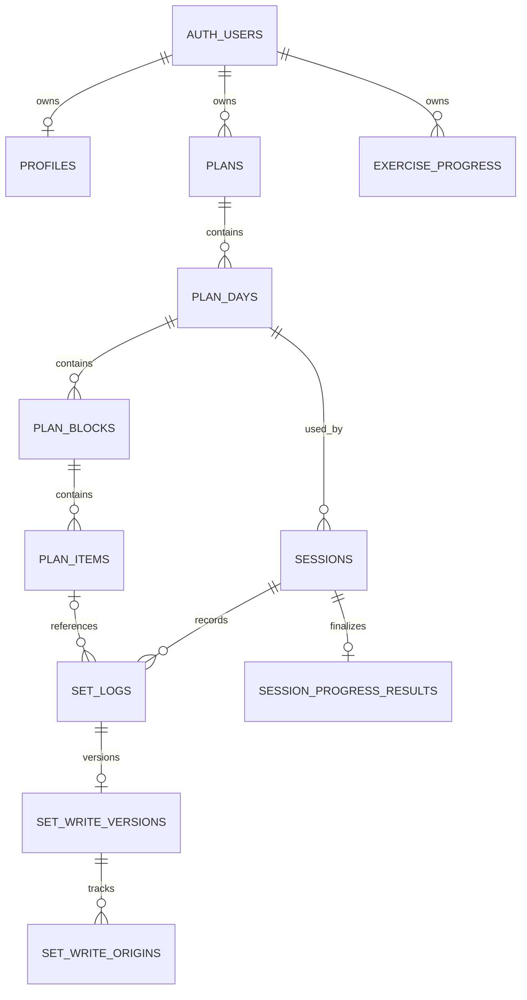
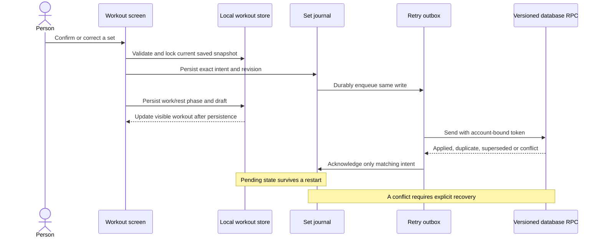

# Architecture and infrastructure

Reviewed 2026-10-22. This document describes the working checkout at `5e2d317`
plus uncommitted changes inspected during this review. The shared checkout
received further implementation work while these guides were being written;
the descriptions below include the newly added preference, privacy, session
context, calendar and migration-baseline modules. They remain local candidates.
This is a source audit, not evidence
that a particular app build or hosted database runs that code. The exact gym
filter and manual native publishing guard are local candidate changes. The
[Git workflow](GIT_WORKFLOW.md) records the difference from remote `master`.

The document separates the existing system from a proposed evolution. Read
sections 1–8 to understand what runs today; sections 9–12 describe what to change
and how to verify it. [Technical decisions](TECHNICAL_DECISIONS.md) explains how
to record and review those changes.

## Contents

- [1. Product requirements that shape the architecture](#1-product-requirements-that-shape-the-architecture)
- [2. System boundary and infrastructure](#2-system-boundary-and-infrastructure)
- [3. Deployment environments and trust boundaries](#3-deployment-environments-and-trust-boundaries)
- [4. Code structure and responsibilities](#4-code-structure-and-responsibilities)
- [5. Database model and authoritative operations](#5-database-model-and-authoritative-operations)
- [6. Runtime walkthroughs](#6-runtime-walkthroughs)
- [7. Failure behavior, observability and operations](#7-failure-behavior-observability-and-operations)
- [8. Tests and evidence boundaries](#8-tests-and-evidence-boundaries)
- [9. Proposed architecture evolution](#9-proposed-architecture-evolution)
- [10. Detailed implementation sequence](#10-detailed-implementation-sequence)
- [11. Invariants to protect during any change](#11-invariants-to-protect-during-any-change)
- [12. Research used and deliberately adapted](#12-research-used-and-deliberately-adapted)

## 1. Product requirements that shape the architecture

The product must turn a person's goals, experience, available time, limitations,
exercise preferences, and this gym's equipment into a workout they can follow
with little phone interaction. This makes correct selection and durable set
logging more important than adding services.

The current app covers some of that promise. Goal, experience, frequency, session
length, and limitations affect questionnaire plans and are now editable through
the training-preference component. Bodyweight contributes to load statistics.
Height is stored and displayed, but does not change exercise selection.
Preferred/excluded exercise IDs are still not persisted inputs. The authored PPL
path now filters or replaces movements using equipment, experience and
limitations; it still uses its authored split and prescriptions. These limits
need explicit product work, not a claim that the planner understands a body
"type".

These proposed quality scenarios make the goal testable:

| Scenario | Required behavior | How to demonstrate it |
| --- | --- | --- |
| First useful plan | No selected movement requires unconfirmed equipment. Optional identity work does not delay the first plan. | Generate across input combinations, then complete fresh-account onboarding on a phone. |
| Phone locks during rest | Remaining time follows the saved deadline, including pause semantics. | Lock/background/reopen on installed iOS and Android builds. |
| Connection disappears after starting | Logged sets and corrections survive a process restart. The app distinguishes saved locally from synced. | Inject an outage, restart, reconnect, inspect the final server records and receipt. |
| Another device edits a set | A stale correction cannot silently replace the newer server value. | Exercise both transaction orders with separate PostgreSQL connections and explicit conflict review. |
| Account switches during a request | A write remains bound to its original account; the new account never sees the old workout. | Switch accounts during an in-flight write and recovery read. |

The use of explicit scenarios follows [arc42's quality guidance](https://docs.arc42.org/section-10/).
They are proposed acceptance criteria, not measured service-level objectives.

## 2. System boundary and infrastructure

Office Gym is one shared Expo application deployed to native devices and a
browser, with a managed Supabase backend. The planner runs on the client.
Database functions provide transactional server behavior. Cloudflare serves the
web files; it is not a custom workout API in this repository.

This view separates software responsibilities from deployment locations, using
[the C4 deployment approach](https://c4model.com/diagrams/deployment).

Arrows show delivery or requests. Local storage belongs to a device/browser,
not to the server. Supabase's managed Auth, PostgREST Data API, database and
Storage are distinct responsibilities behind its project endpoint. This project
uses those services through the SDK; it does not deploy their internal services.
See [Supabase's architecture](https://supabase.com/docs/guides/getting-started/architecture).

### Infrastructure inventory

| Element | Repository evidence | Operational meaning |
| --- | --- | --- |
| Native application | [app.json](../app.json), [package.json](../package.json) | Expo SDK 57, React Native, portrait dark UI; scheme `officegym`; iOS/Android identifier `co.officegym.trainer`. |
| Expo delivery | [app.json](../app.json), [eas.json](../eas.json) | EAS project `aa04a2aa-93a1-4e8f-ad57-84ed3e8c2bf5`; fingerprint runtime compatibility; separate build profiles and update channels. |
| Web hosting | [wrangler.jsonc](../wrangler.jsonc) | Worker `personal-trainer`, static `dist/`, single-page fallback. Build runs checks before export. Hosted triggers remain external configuration. |
| Web testing address | [Cloudflare runbook](CLOUDFLARE_RELEASE.md) | `https://personal-trainer.sautonmateo.workers.dev`; the runbook contains prior deployment evidence, not a live version check for this document. |
| Database/Auth/Storage | [Supabase client](../lib/db/supabase.ts), [migrations](../supabase/migrations/), [baseline manifest](../supabase/migration-baseline.json) | URL/key come from build configuration. The manifest records a historical production reference; its history mappings remain unverified. Region, backups, live project identity and applied state need separate evidence. |
| Account-deletion backend | [function adapter](../supabase/functions/delete-account/index.js), [function config](../supabase/config.toml) | An authenticated Edge Function performs server-only Auth/Storage admin operations. Source presence is not a deployment or hosted verification result. |
| Exercise assets | [catalog builder](../scripts/build-catalog.mjs), [media provider](../lib/media/provider.ts) | Bundled metadata references remote images. Current source image URLs use upstream `@main`, so remote content is mutable. |
| CI | [candidate workflow](../.github/workflows/checks.yml) | GitHub checks and a gated native publish job in this checkout. Its presence does not prove the remote default branch has adopted it. |
| Legacy web mirror | [vercel.json](../vercel.json) | A Vercel static export configuration remains. It is not proof of an active release target or isolation. |

The deletion Edge Function is a privileged account-lifecycle boundary. The
workout flow otherwise calls the managed Data API and RPCs directly; it does
not need a separate workout application server, message broker or model service.
Do not infer deployed capabilities from a dependency merely appearing in
`package.json`.

## 3. Deployment environments and trust boundaries

Three independent things are often called an environment: a Git branch, a set
of build variables/update channels, and a backend containing accounts and data.
Only the last one establishes data isolation.

| Execution path | Configuration selection | Backend and data implication |
| --- | --- | --- |
| Local mock | Explicit URL `http://127.0.0.1:54321`, key `mock`, `EXPO_NO_DOTENV=1` | `tools/dev/mock-supabase.mjs` holds disposable fixtures. It does not establish real Auth, RLS, SQL concurrency or file-service behavior. |
| Local real app | `npm run env:pull` selects EAS development variables | Reads whatever Supabase URL was configured. A development name does not guarantee a development database. |
| Native development | `development` profile, development client | Uses EAS development configuration; backend project must be checked independently. |
| Native preview | `preview` profile/environment/channel, internal distribution | Separate app delivery route. Data separation requires a different Supabase project or deliberately scoped test accounts. |
| Native release test | Extends production profile; internal distribution; `release-test` channel | Uses production environment configuration. Separate channel protects update delivery, not production records. |
| Native production | `production` profile/environment/channel | Fingerprint-compatible updates reach installed native runtimes. Clients do not all update simultaneously. |
| Cloudflare preview/primary web | Hosted build variables and trigger | Both can point at the same backend. `wrangler.jsonc` does not declare a separate preview database. |

The proposed target is two managed backend projects initially: development and
production. Local integration, PR previews, and preview native builds use the
development project with separate disposable accounts. Production binaries and
final production-configuration smoke tests use production, with a designated
test account and a written cleanup rule. Per-PR databases can follow if shared
development data becomes a real bottleneck. The complete mapping belongs in
[Git environments](GIT_WORKFLOW.md) and [release operations](RELEASES.md).

The publishable key is bundled configuration. Authorization comes from the user
token, grants, row-level security and function ownership checks. Service-role
keys and database credentials must never enter `EXPO_PUBLIC_*`. This is the
[Data API access model](https://supabase.com/docs/guides/database/secure-data),
not a reason to hide database permissions inside UI checks.

Native sessions currently persist through AsyncStorage. Account scoping protects
against application account mixups; it is not a documented encryption or
hardware-backed secure-storage guarantee. The original avatar bucket policy was
public. A new local migration changes it to private owner reads and the new
client obtains five-minute signed URLs. This is a paired client/bucket cutover;
it does not establish that hosted public access has already been disabled.

## 4. Code structure and responsibilities

The static module view follows [arc42's building-block guidance](https://docs.arc42.org/section-5/).
A route renders UI and coordinates a use case; domain modules calculate results;
storage and database adapters enforce their respective persistence contracts.
The existing code sometimes combines these roles in large screens.

| Subsystem | Files to read | Input, output and responsibility |
| --- | --- | --- |
| Navigation and identity | [root layout](../app/_layout.tsx), [AuthProvider](../lib/auth.tsx), [profile gate](../lib/auth-gate.ts) | Restored session plus profile state determines sign-in, recovery, onboarding or app routes. An unavailable profile is distinct from a missing profile. |
| Sign-in callbacks | [deep links](../lib/deep-link.ts), [social sign-in](../lib/social-auth.ts), [crypto](../lib/auth-crypto.ts) | PKCE callback validation, browser/native provider interaction, recovery state and account continuity. Provider visibility flags do not configure the providers. |
| Training input | [onboarding](../app/onboarding.tsx), [training editor](../components/TrainingPreferences.tsx), [input contract](../lib/plan/preferences.ts) | Collects/edits goal, level, schedule, equipment categories and limitations. Preferred/excluded exercise IDs and individual machine availability are not persisted fields yet. |
| Plan eligibility | [office-gym policy](../lib/plan/office-gym.ts), [catalog](../lib/catalog.ts) | Intersects saved equipment with the known inventory and filters exact exercise IDs, level, patterns and limitations. |
| Plan prescription and swaps | [generator](../lib/plan/generate.ts), [splits](../lib/plan/splits.ts), [preset adapter](../lib/plan/swaps.ts), [swap UI](../components/ExerciseSwap.tsx) | Builds ordered days/blocks/items. Goal sets generated schemes; duration affects rest/rounds. The preset adapter applies eligibility to authored work. Swaps occur before a workout, not inside its active snapshot. |
| Dashboard and calendar | [useDashboard](../lib/useDashboard.ts), [calendar](../lib/calendar-days.ts), [calendar clock](../lib/useCalendarToday.ts), [estimates](../lib/plan/estimate.ts) | Queries plan/history/progress and computes next day/totals. Calendar dates are derived from session timestamps in a stable home timezone. This remains a shared hook definition, not a persistent cross-screen query cache. |
| Workout execution | `app/session/[dayId]/index.tsx`, `run.tsx`, `summary.tsx`; [queue](../lib/session/queue.ts), [timing](../lib/session/timing.ts) | Starts, runs and completes a session. Queue order and deadline clocks are domain behavior, separate from displayed components. |
| Local durability | [workout store](../lib/session/workout-store.ts), [journal](../lib/session/set-journal.ts), [outbox](../lib/session/outbox.ts), [locks](../lib/session/storage-lock.ts) | Preserves the screen position, exact set intents and retry operations across restarts. |
| Synchronization | [sync](../lib/session/sync.ts), [queries](../lib/db/queries.ts) | Binds transport to the correct account, captures baselines, sends/retries writes, rejects stale acknowledgements and stages recovery. |
| Progression | [load rules](../lib/progression.ts), [weight suggestions](../lib/weights.ts), summary route | Derives suggested loads from recorded work; commits results through a version-checked database transaction. New external-load exercises start without an invented load. |
| UI and media | [UI primitives](../components/ui.tsx), [theme](../lib/theme.ts), [exercise image](../components/ExerciseMedia.tsx) | Shared controls/tokens and static start-position images. Some authored movements have instructions with no demo image. Current media is not an animated movement demonstration. |
| Export, privacy and repair | [export](../lib/account-export.ts), [local recovery](../lib/session/recovery-data.ts), [avatar](../lib/avatar.ts), [deletion client](../lib/account-delete.ts) | Server export can include raw owner-scoped local recovery data. Local recovery export/repair can work without the backend. Deletion freezes identity and clears local owner data only after confirmed server deletion. |

### How prescriptions and numbers are produced

The questionnaire generator chooses a split for two to six training days,
then builds a warm-up and four work blocks: primary, secondary, superset and
finisher. Goal selects the sets/rep ranges. The 30/45/60-minute input changes
rest periods and finisher rounds; it is not a guarantee that a human finishes
at exactly that minute. A seeded shuffle makes the same supported input
reproducible. The catalog filters eligibility before choosing a movement.
Fallbacks can broaden movement patterns or repeat eligible work, while the
office-gym exact-ID constraint remains in force.

The PPL preset is different. `withDayTiming` allocates a five-minute warm-up
and four work blocks of at least six minutes to a total of 2,820 seconds.
It weights estimated work, recovery, tempo and unilateral repetitions, then
allocates integer seconds without losing rounding remainders. Those block
budgets are derived again when the stored preset loads; they are not columns
in the current `plan_blocks` table. The queue expands straight sets as A1,
A2, A3 and a superset as A1, B1, A2, B2. The player is a cursor over that queue.
Deadlines store an end timestamp, rather than depending on interval ticks to
survive background suspension. Explicit pause/resume shifts the deadline.

Load is stored in kilograms and converted for display. A bodyweight set stores
added load separately; `effectiveLoadKg` adds the bodyweight supplied by its
caller, or returns unknown when that value is unknown. New local workouts
capture bodyweight/units for the player and summary. Dashboard totals use the
current profile value. New source adds server-captured session units/bodyweight
and an immutable context marker. The summary uses a known captured local
context or reads the server context; legacy sessions with unknown context do
not invent bodyweight estimates or progression from today's profile. This
candidate requires the matching migration. It does not synchronize the entire
active workout cursor/draft across devices.
Progression
uses the working external/added load. All logged rep sets reaching the upper
target at reported RPE no greater than eight can increase the suggestion.
Missing RPE currently counts as manageable. Two consecutive misses below the
lower target trigger a plate-rounded deload near ten percent. Zero/unknown
working loads do not produce an invented increase. Upper-body increments are
2.5 kg or 5 lb; lower-body increments are twice that. These are existing rules,
not a body-type adaptation model. Source: [progression](../lib/progression.ts),
[units](../lib/units.ts), [queue](../lib/session/queue.ts), and
[timing allocation](../lib/plan/timing.ts).

## 5. Database model and authoritative operations

Postgres stores user plans and workout facts. The catalog itself is bundled in
the app; `exercise_id` is a stable text reference, not a foreign key to a server
exercise table. Removing an exercise ID can therefore break old plans even when
all SQL constraints still pass.

The diagram omits non-key columns. `AUTH_USERS` represents `auth.users`, not an
extra public table. Source definitions and later overrides are in
[the migrations](../supabase/migrations/).

| Tables | Stored meaning and protection |
| --- | --- |
| `profiles` | Account settings and training inputs; owner matches the Auth user ID. Includes bodyweight, height, equipment and limitations. |
| `plans`, `plan_days`, `plan_blocks`, `plan_items` | Persisted prescriptions and order indexes. A partial unique index permits one active plan per user. Retiring a plan preserves its history. |
| `sessions` | A particular attempt at a plan day; start/completion/duration plus event-local calendar day and timezone. Parent ownership must match the user. |
| `set_logs` | Actual reps or seconds and external/added load. Item/exercise/day ownership must agree. Set corrections use the versioned RPC, not direct client writes. |
| `exercise_progress` | Current suggestion/best/miss-streak state, keyed by account and exercise. Clients read it; progression RPC writes it. |
| `session_progress_results` | One completion result/receipt per session, including historical markers. Owner-readable; not a client-editable ledger. |
| `set_write_versions`, `set_write_origins` | Internal server-version and per-origin/revision metadata. Client table access is revoked; reviewed functions access it. |

The latest candidate migrations add `profiles.home_timezone` and session
calculation units/bodyweight/context-captured fields. A trigger prevents later
updates to captured session context. Historical values are explicitly unknown.
The home-timezone migration retains recorded `local_day`/`tz` facts while the
current dashboard derives visible dates from `started_at` in the home timezone.
The new calendar clock refreshes at the next home midnight and on app resume.

The important interfaces are SQL functions exposed through `supabase.rpc`:

- `save_plan(jsonb)` retires the old active plan and inserts the complete new
  hierarchy in one transaction. It uses the caller's permissions and RLS.
  Onboarding's later profile update is a separate request; the complete
  onboarding operation is not one database transaction.
- `log_set_versioned(...)` validates account/session/item identity, canonical
  payload, revision and expected server version. Replays can be duplicates;
  older revisions can be superseded. Cross-origin conflicts require review.
- `get_set_write_state`, `check_legacy_set`, and `get_session_set_snapshot`
  provide owned server state for correction/recovery. The last returns logs
  and complete version membership from one snapshot.
- `apply_session_progress(...)` checks the set snapshot and prior progress,
  updates progress and writes a receipt atomically. The current client uses
  five arguments, including set versions. It returns a previously committed
  result on replay; stale input can produce `40001` and a bounded recalculation.
- `export_account_data()` returns the authenticated user's synced data.
- `save_training_plan(preferences, plan)` locks the profile and updates its
  core training fields together with the plan transaction. The training editor
  uses this paired operation; initial onboarding still has separate requests.
- `replace_plan_exercise(...)` compares the expected exercise and preference
  snapshot, requires owned active-plan membership, and refuses a day with an
  unfinished session. Catalog/movement eligibility is currently validated by
  the client. The SQL has no server catalog from which to verify suitability.

Some functions use `SECURITY DEFINER` to operate on protected internal state.
They must retain explicit ownership checks, restricted execution grants and
controlled search paths. Their security cannot be inferred from the ordinary
table policies alone.

Migration `0007` revokes direct set writes and the older progression signature.
It is a compatibility boundary for installed clients and queued operations.
The later timed-set migration preserves legacy rep payload shapes while adding
seconds. Read [ordered writes](ORDERED_SET_WRITES.md) and
[Supabase operations](../supabase/README.md) before changing these contracts.
A directory of migrations is not proof that production has applied them.

## 6. Runtime walkthroughs

These scenarios connect concrete modules and failures, following the purpose of
an [arc42 runtime view](https://docs.arc42.org/section-6/).

### 6.1 Sign in and build the first plan

1. The root layout mounts AuthProvider. It restores the Supabase session,
   listens for auth changes and handles validated auth URLs.
2. The profile request selects the account's state. A cached profile can help
   on an initial read failure. Recovery/profile errors stay distinct from a new
   user needing onboarding.
3. Onboarding produces inputs. `generateOfficeGymPlan` passes exact eligible
   gym IDs into the deterministic generator; every fallback remains constrained.
4. `save_plan` persists the hierarchy. The profile update then marks onboarding
   complete. An avatar upload failure is tolerated. A failed profile update
   can leave a saved plan with onboarding unfinished; retry must be considered.
5. Refreshing the profile opens the tab routes. Home loads the active plan and
   history and selects the next day after the last completed day of that plan.

The authored PPL activation follows a separate path through
[GymRoutineCard](../components/GymRoutineCard.tsx) and
`generateSafeGymRoutine`. It now filters the exact pool by saved equipment,
experience and limitations, replacing eligible movements or omitting unsupported
items. It fails if any block becomes empty. It remains an authored six-session
rotation with fixed prescriptions; filtering is not goal-specific reprogramming.
Activation and swaps are blocked while a local workout exists. Server swap
checks also reject a target day with an unfinished server session.

### 6.2 Start, log, correct and recover a set

Starting a new session requires the server plan/progress and a parent-session
insert. The overview then persists a local snapshot before opening the player.
If local persistence fails after insertion, its retry retains that session ID.
The snapshot captures the original day, units, bodyweight context, queue cursor,
drafts and timers. Rebuilding the active plan does not rewrite that workout.

This is a logical view of set completion. The journal intent and queue entry
are durable before the work/rest phase transition commits. Sending can begin
after enqueue, before that phase write finishes; the diagram does not imply a
network ordering guarantee. A failure in the final snapshot write therefore
does not imply that the set was never queued. The journal makes interrupted
enqueue recoverable. Rest corrections enter the same protocol through their
own guarded screen action.

For a correction, the journal keeps the set's origin, increases its revision,
and preserves its original completion event time. A captured server baseline
prevents later reads from silently authorizing a stale overwrite. Network
failure leaves the operation pending. Conflicts preserve both local evidence
and server state for review; they do not become blind retries.

Native storage serializes access per key within the runtime. Web uses Web Locks
for shared storage; unsupported browsers fail before mutation. Recovery that
needs several stores follows workout, journal, outbox lock order. On sign-out,
replay pauses and account generations invalidate old responses. The queued work
remains available to its original account. Clearing app storage would destroy
that recovery evidence.

### 6.3 Finish the workout and update future loads

The player can preserve finished work locally and queue completion during an
outage. A new [offline summary](../lib/session/offline-summary.ts) computes
provisional totals from the owned finished snapshot and recorded sets. It does
not assign progression verdicts or personal records. That feedback is different
from producing a finalized server summary.

The summary flushes the outbox, checks unresolved/pending operations, and looks
for an existing receipt. Otherwise it loads the original session day, the atomic
set snapshot and progression baseline. It computes totals/load changes, then
calls `apply_session_progress` with expected versions. A stale response reloads
both sets and progress before recalculation, up to the bounded retry limit.
The active snapshot clears only after a successful receipt path. A finalization
race must not quietly accept an unreviewed late correction.

This explains why the UI needs separate states for "saved on this phone",
"waiting to sync", "needs review", and "complete on the server".

### 6.4 What actually works offline

| Operation | Existing boundary |
| --- | --- |
| Read bundled exercise metadata / generate a plan object | Local calculation; saving/activating the plan still needs the backend. |
| Resume a previously saved workout | Local snapshot supports it, subject to available account/session state and valid stored data. |
| Record new sets in an active workout | Local journal/outbox preserve intent for later replay. Some historical corrections require a server baseline or explicit recovery. |
| Start a brand-new workout | Currently requires server reads and a parent-session insert. |
| Show local completion totals | The new provisional summary uses a valid finished snapshot with recorded sets; it does not finalize progression or clear the recovery copy. |
| Produce a fresh finalized summary | Requires successful synchronization and transactional server processing. |
| Read exercise images never downloaded | Requires the CDN. Cached images are opportunistic, not a complete offline media package. |
| Use another device to resume this device's exact cursor/drafts | No server-synchronized workout snapshot contract exists. |

### 6.5 One concrete set through the system

Consider a synthetic intermediate plan with a barbell bench-press item for
four sets of six to ten reps. The stored `plan_items` row has an exercise text
ID, the prescription, and its own UUID. The screen resolves that exercise ID
against the bundled catalog and obtains the instructions and available image.
An existing history/progress target can prefill the weight; otherwise the user
enters it.

The user logs nine reps at 20 kg. The workout draft captures the displayed
values; the set payload contains `reps: 9`, `weight_kg: 20`,
`is_bodyweight: false`, `added_load_kg: 0`, and the plan-item/set identity.
The journal adds origin, revision, expected server version and event time.
The outbox sends that exact intent with the user's token to the versioned RPC.
The server writes the set and version metadata, then returns a result that
can acknowledge that revision.

If the user corrects nine to ten reps, the new intent gets revision two and
retains the original event time. If revision one arrives after revision two,
it cannot roll the set back to nine. A correction from another origin against
a stale baseline instead requires explicit review. A repeated network send
does not create an extra performed set.

Once the workout is synced, the summary reads all sets with their versions.
If every eligible logged rep set reached ten with manageable or absent RPE,
the current upper-body rule proposes 22.5 kg for the next workout. The server
commits the progression update and its receipt together. Reloading the summary
returns the receipt rather than adding another increment. If a set changed
between read and commit, the version check rejects the calculation and the
client reloads.

[Joplin's public sync specification](https://joplinapp.org/help/dev/spec/sync)
was useful because it documents local facts, transport and reconciliation
separately. This app has partial offline recovery, not Joplin's full replicated
local database model. Copying a full sync engine would be a separate product and
storage decision.

## 7. Failure behavior, observability and operations

| Failure | Current behavior / limitation | Required operational response |
| --- | --- | --- |
| Supabase or network unavailable | New starts and summaries can block; active-workout intents can remain local. | Preserve storage, distinguish API availability from auth rejection, retry the original session/write identity. |
| Disk write fails or snapshot is invalid | Store validation fails and preserves data; UI should keep the current step. | Reproduce with fault injection. Never repair by silently discarding drafts. |
| Stale set / finalized receipt | Version protocol returns review/finalization errors. | Inspect saved intent and owned server snapshot; recover explicitly. |
| Exercise image missing | Media area can be blank; instructions remain separate. | Verify the text is adequate; add an honest unavailable-media state before relying on demos. |
| Wrong catalog ID or changed instructions | SQL may still accept text IDs that an older bundle cannot resolve. | Restore stable IDs/aliases and test old plans against the new catalog. |
| Avatar access / export | New private-path/signed-URL client and owner-read migration are local candidates. Export can include raw local recovery values. | Verify paired hosted bucket/client cutover, URL expiry, native sharing and recovery retention; do not assume old public images can be recalled. |

The new deletion function verifies the bearer token through Auth, matches the
explicit account confirmation, removes that owner's photos, revokes refresh
sessions and deletes the Auth user. Existing foreign keys cascade app rows.
The client pauses replay and deletes only the confirmed owner's local keys after
a confirmed response. Ambiguous responses preserve local evidence; another
signed-in account must not be signed out. These steps span services and are not
one SQL transaction. Hosted Auth/Storage behavior, cascade and revoked-session
effects still need integration evidence. See [privacy controls](PRIVACY_CONTROLS.md).

Local repair keeps a byte-preserving backup of damaged queue data and requires
review before replacement. The unowned legacy global queue is never assigned
automatically to whichever user is signed in. Account export includes raw
owner-scoped storage when requested; it is not a full device or multi-device
backup and omits other devices' unsynced data.

`lib/observe.ts` wraps Expo Observe and disables unsupported native modules in
Expo Go. `markInteractive` is called after startup blocking gates clear. That
measures one application milestone. It does not demonstrate a monitored workout
funnel, backend alert policy, crash-reporting service, or an incident dashboard.

Propose minimal privacy-aware events for plan creation, workout start, locally
saved set, pending-sync age, reviewed conflict and finalized completion. Record
release/runtime identity and opaque correlation identifiers; avoid tokens,
passwords, free-text limitations and body measurements in diagnostics. Keep
user analytics separate from correctness logs and define retention before
sending events to a new service.

## 8. Tests and evidence boundaries

`npm run check:web` runs TypeScript, Jest and disposable database checks. The
candidate CI additionally exports a web bundle with mock public configuration.
Database scripts cover migrations, ownership, replay, ordering, timed writes
and exports. New baseline tooling pins nine historical files by hash and
rehearses fresh-schema and baseline-plus-new-migrations paths, comparing
schema/permissions and preserving fixtures. Production-version mappings remain
null. These are source-baseline checks, not a production restore or permission
to push SQL. PGlite's single connection cannot prove concurrent transaction
races. The ordering harness supports separate-connection local PostgreSQL
checks; installed phone flows remain separate evidence.

The mock backend and browser driver help reproduce UI behavior. They cannot
prove production Supabase configuration or native provider callbacks. No unit
suite establishes mobile reachability, large-text layout, keyboard behavior,
background scheduling, or store distribution. Record the exact test target and
build/runtime when claiming those behaviors.

## 9. Proposed architecture evolution

Keep one modular application and the current managed backend. The evidence does
not justify introducing microservices or replacing the ordered-write protocol.
Make the inputs and application use cases easier to understand and test.

### 9.1 Explicit training profile and eligibility policy

Create one versioned training-input contract for goal, level, time budget,
limitations, preferred and excluded exercise IDs, gym inventory identity and
units. Core goal/schedule/equipment/limitation editing and atomic paired-plan
save now exist locally. Extend that work with preferred/excluded IDs, explicit
inventory identity and compatible defaults. Those missing fields are not
implemented by merely naming the existing editor TrainingPreferences. Keep
optional measurements genuinely optional.

Separate `eligibleExercises(context)` from ranking/prescription. Equipment,
exclusions and supported limitations are hard filters; preference and variety
rank the remaining pool. If no suitable candidate exists, explain the missing
coverage instead of silently expanding equipment. Apply the policy to generated
plans, authored preset review, and future swaps. Current preset adaptation
filters/replaces items and rejects empty blocks. An explicit eligibility report
would make those substitutions and omissions reviewable before activation.

The current allowlist derives from the authored preset. Move it into an explicit
reviewed inventory/capability module only when it can retain the same IDs and
regression guarantees. Do not let adding a preset exercise silently authorize
new machinery for all generated plans.

### 9.2 Application use cases between screens and storage

Extract focused operations for creating a plan, beginning a workout, recording
a set, choosing a recovery value and finalizing a summary. Keep screens focused
on state presentation and user actions. Preserve the existing disk-before-advance,
account-token and version-check contracts while extracting them. Start with one
use case and verify behavior; a wholesale route rewrite adds unnecessary risk.

Make initial onboarding resilient to its separate profile and plan writes.
The new training editor already uses `save_training_plan` for paired updates.
Extend the suitable transactional boundary to onboarding or define an explicit
retryable onboarding state. Do not mark onboarding complete before a usable
plan exists.

### 9.3 Stable plan, catalog and session versions

Add generation-policy/catalog revision metadata to future plans so a workout can
explain which rules created it. Keep old exercise IDs readable. A swap after
work has started must preserve logged item identity and the original day
snapshot. Treat editing future prescriptions separately from rewriting an active
or finalized session. The new calculation-context migration now provides
immutable server units/bodyweight for new sessions. Verify its old/unknown
context behavior; full cross-device cursor/draft resume is still separate work.

### 9.4 Infrastructure that can be reconstructed

Record public project identifiers, environment-to-backend mapping, callback
allowlists, channel/runtime choices and deployment owners without recording
secret values. A minimal `supabase/config.toml`, pinned-source baseline manifest,
read-only planner and upgrade-rehearsal tests now exist locally. The manifest
records historical production project `asbudyijvunpnhrhsubm`; null history
mappings mean reconciliation is unfinished. A local project name and function
entrypoint do not constitute a fully bootstrapped Supabase stack. Complete
authorized production-history review and a supported local setup before linked
migration automation. See [migration baseline](MIGRATION_BASELINE.md).

Pin exercise media to an immutable source revision and define which assets must
be prefetched/downloaded for a reliable workout. Introduce a persistent read
cache only after choosing its account scoping, freshness and sign-out behavior.
That is the prerequisite for starting entirely offline, not an effect of using
AsyncStorage for writes.

## 10. Detailed implementation sequence

All items below are proposals. They do not provision infrastructure or change
runtime behavior as part of this documentation task.

| Stage | Concrete changes | Dependencies and acceptance evidence |
| --- | --- | --- |
| 1. Establish the actual deployment baseline | Reconcile remote master with the local candidate; inventory EAS/Cloudflare/Supabase public IDs and applied migrations; record which native clients remain active. | Read-only environment review first. No claim of isolated preview or compatible production migration without this record. See [release plan](RELEASES.md). |
| 2. Verify and consolidate eligibility | Review current constrained preset and pre-start swap candidates; separate reviewed inventory from preset content; expose the substitutions/omissions report. | Keep allowlist and empty-block regressions. Verify client-side eligibility separately from SQL ownership checks and both machine dependencies. |
| 3. Extend persisted training inputs | Validate the current editor and atomic paired-plan RPC, then add preferred/excluded IDs and ranking through a compatible migration/contract. | Old clients tolerate new fields; future exclusions survive save/restart/rebuild. Existing schedule/equipment editing is verified rather than rebuilt. |
| 4. Make first-plan creation recoverable | Extract onboarding use case; define atomic or retryable profile/plan save semantics. Defer optional photo/measurement screens. | Inject failure between plan save and profile update; retry produces one usable active plan and preserves entered constraints. |
| 5. Verify pre-start swaps, design active-session changes separately | Test existing active-plan compare-and-set and unfinished-session refusal; decide new item/revision semantics before permitting a mid-session swap. | Current swaps cannot alter a running snapshot. Any later live-session design preserves logged sets, original context and valid server references. |
| 6. Extract the player incrementally | Move one coordination use case at a time out of `run.tsx`/`summary.tsx`; keep queue/timing rules pure and adapters explicit. | Regression tests retain origin/revision/event time, lock order, account isolation and receipt behavior. Phone restart/background/offline checks pass. |
| 7. Improve read/media reliability and visibility | Choose a scoped read-cache contract; pin/download required assets; implement minimal redacted diagnostics. | Cold/warm phone measurements establish targets. Never-downloaded media and API outages have explicit UI behavior. Incident evidence identifies build/runtime without private payloads. |

## 11. Invariants to protect during any change

1. Every selection path respects the same confirmed equipment and explicit exclusions.
2. Catalog IDs used in saved plans, history or queued writes remain resolvable.
3. A visible workout advance follows successful local persistence.
4. Replay preserves exact payload identity, revision, baseline and event time.
5. A stale acknowledgement cannot erase a newer correction.
6. Account switching cannot retarget an in-flight request or reveal another account's stored state.
7. A final receipt freezes acknowledged workout facts; progression cannot be applied twice.
8. A schema/update rollout remains compatible with installed clients and retained outboxes, or has an explicit retirement/recovery plan.

A proposed refactor that cannot explain these invariants is not ready to merge.

## 12. Research used and deliberately adapted

- [C4 model, deployment diagrams](https://c4model.com/diagrams/deployment). Used separate execution locations and labeled connections; did not add every C4 diagram level.
- [arc42 building blocks](https://docs.arc42.org/section-5/), [runtime](https://docs.arc42.org/section-6/), [deployment](https://docs.arc42.org/section-7/), and [quality scenarios](https://docs.arc42.org/section-10/). Used complementary views, failure paths and acceptance scenarios rather than a directory list.
- [Supabase architecture](https://supabase.com/docs/guides/getting-started/architecture) and [secure data access](https://supabase.com/docs/guides/database/secure-data). Used the real client/Data API/database trust model; did not treat frontend guards as authorization.
- [Expo Router concepts](https://docs.expo.dev/router/basics/core-concepts/). Used the distinction between file routes, layouts and native/web execution. Runtime/update policy is detailed in [releases](RELEASES.md).
- [Joplin architecture](https://joplinapp.org/help/dev/spec/architecture/) and [sync specification](https://joplinapp.org/help/dev/spec/sync). Used the community project's separation of UI, services, storage and reconciliation. Its replicated local database and server are not this app's current design or a required replacement.

The descriptions above come from this repository. External sources supplied the
documentation methods and comparison points; they do not verify this app's
production settings or exercise suitability.
